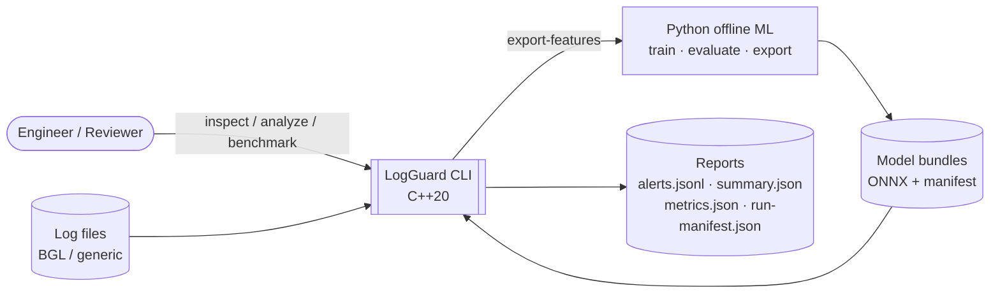
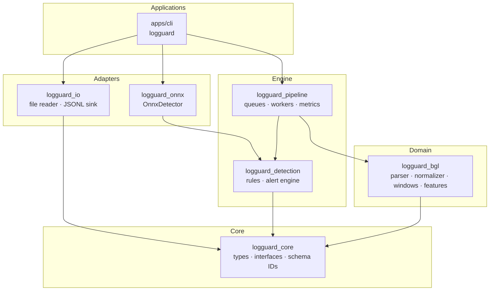
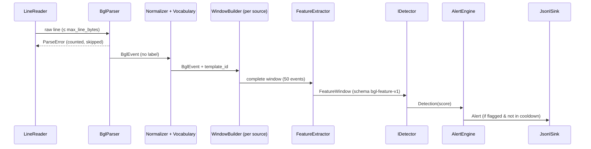

# LogGuard — Architecture

| | |
|---|---|
| **Document status** | Living document — updated with every architectural change |
| **Version** | 1.0 |
| **Last updated** | 2026-11-12 |
| **Product status** | M0 (Foundation) — complete · M1 next |
| **Decision log** | [`docs/adr/`](adr/README.md) |

---

## 1. Overview

**LogGuard** is a local-first, native C++20 engine that detects anomalous behavior in system logs.
It ingests log files, parses and normalizes records, groups them into fixed-size windows, extracts a versioned numeric feature vector, scores each window with a rule-based or machine-learning detector, and emits explainable, machine-readable alerts.

Models are trained offline in Python and deployed as versioned **ONNX** bundles. At runtime the C++ binary scores logs **without a Python interpreter**.

### 1.1 Product scope

| Edition | Status | Summary |
|---|---|---|
| **LogGuard Core** | **In development** | C++ CLI for BGL / generic log analysis: parsing, windowing, features, rules + ONNX detection, JSONL reports, concurrent replay. |
| LogGuard Edge | Planned extension | ESP32-S3 + FreeRTOS firmware streams sensor and runtime-health telemetry to the Core host for anomaly detection. Started only after Core v1.0. See [§20](#20-extension-logguard-edge). |
| Web demo | Optional | Thin HTTP adapter + dashboard over the Core libraries. |

### 1.2 Audience

Engineers who build, review, or extend LogGuard. Read §2–§8 for design and §15–§17 to start developing.

---

## 2. Goals and Non-Goals

### 2.1 Functional requirements

| ID | Requirement |
|---|---|
| FR-1 | Parse Loghub **BGL** log files and report parse statistics (`logguard inspect`). |
| FR-2 | Normalize messages into event templates using a vocabulary fitted on training data only. |
| FR-3 | Build ordered, per-source windows of a fixed size and extract a versioned feature vector. |
| FR-4 | Score windows with a **rules detector** and an **ONNX model detector** behind one interface. |
| FR-5 | Emit alerts (JSONL), a run summary, metrics, and a reproducibility manifest. |
| FR-6 | Export feature vectors for offline training (`logguard export-features`). |
| FR-7 | Refuse to run a model whose schema / domain / vector shape does not match the pipeline. |
| FR-8 | Replay large files with bounded memory using a concurrent pipeline. |

### 2.2 Non-functional requirements

| ID | Quality | Requirement |
|---|---|---|
| NFR-1 | Correctness | Identical input + config + model ⇒ byte-identical alerts, regardless of thread count. |
| NFR-2 | ML validity | Ground-truth labels never reach runtime types; chronological splits; test set evaluated once. |
| NFR-3 | Reliability | All queues bounded; overload blocks or is counted — never silently dropped. |
| NFR-4 | Robustness | Malformed input is counted and skipped, never crashes the process. |
| NFR-5 | Performance | *Target* ≥ 10,000 BGL events/s end-to-end on documented hardware (measured in M5, not assumed). |
| NFR-6 | Portability | Linux (primary, CI) and macOS (development). gcc and clang. |
| NFR-7 | Reproducibility | Pinned dependencies, versioned schemas/models, run manifests with hashes. |
| NFR-8 | Security | All files (logs, configs, models) are untrusted input with hard size limits. |
| NFR-9 | Maintainability | Small libraries with one-way dependencies; every public unit has tests. |

### 2.3 Non-goals

- Predicting future outages (BGL labels mark *alert events*, not future failures).
- Replacing a log aggregation / observability platform.
- Training models inside the C++ runtime.
- Arbitrary log formats beyond BGL and one documented generic format.
- Distributed deployment, multi-tenancy, or a web UI before the CLI is complete.
- Publishing performance or accuracy numbers that were not measured.

---

## 3. System Context



**Key boundary:** Python only produces artifacts (model bundles, reports). It is never on the runtime path.

---

## 4. Architectural Principles

1. **Label isolation at the parsing boundary.** Ground-truth labels are split from records the moment a line is parsed. Runtime types cannot represent a label. ([ADR-0006](adr/README.md), planned)
2. **One feature implementation.** Training features and runtime features are produced by the *same* C++ extractor (via `export-features`). No re-implementation in Python.
3. **Contracts are explicit and versioned.** Feature schemas, model manifests, and output formats carry IDs and are validated before use. Mismatch ⇒ fail closed.
4. **Domains do not mix.** BGL and (future) Edge telemetry have separate windows, features, schemas, and models. ([ADR-0002](adr/ADR-0002-domain-separation.md))
5. **Bounded everything.** Line length, queue capacity, active sources, file and model sizes all have configured limits. Exceeding one is observable.
6. **CLI first.** The CLI is the product. Any server is a thin adapter over the same libraries. ([ADR-0003](adr/ADR-0003-cli-first.md))
7. **Correct, then concurrent, then fast.** A deterministic single-threaded pipeline is the reference. Concurrency must reproduce its output exactly.
8. **Dependencies point inward.** Domain libraries never depend on I/O, CLI, or third-party ML runtimes.

---

## 5. Logical Architecture

### 5.1 Layers and dependency rules



**Rules**

- An arrow means "may include headers from / link to". Reverse dependencies are forbidden.
- `logguard_core` has **no third-party dependencies**.
- Only `logguard_onnx` links ONNX Runtime, and it is built only when `LOGGUARD_WITH_ONNX=ON`.
- Only `apps/` may depend on CLI11.

### 5.2 Components

| Component | Library | Responsibility | Must not |
|---|---|---|---|
| Core types & interfaces | `logguard_core` | `FeatureWindow`, `Detection`, `IDetector`, `IEventSink`, schema IDs, limits | Depend on anything outside the standard library |
| `BglParser` | `logguard_bgl` | Validate a BGL line, return an event or a typed error; split off the label | Store labels in `BglEvent` |
| `MessageNormalizer` | `logguard_bgl` | Mask volatile tokens (numbers, hex, IPs, paths) into a template string | Depend on vocabulary state |
| `TemplateVocabulary` | `logguard_bgl` | Map template → ID; fitted on training split; serializable | Be refitted at inference time |
| `BglWindowBuilder` | `logguard_bgl` | Per-source ordered windows (size/stride from config) | Mix sources or cross split boundaries |
| `BglFeatureExtractor` | `logguard_bgl` | Produce the `bgl-feature-v1` vector (72 × float32) | Read labels; fit statistics on test data |
| `RulesDetector` | `logguard_detection` | Transparent threshold rules over features | Ignore schema ID |
| `AlertEngine` | `logguard_detection` | Threshold, cooldown, evidence strings, alert IDs | Rewrite ground truth |
| `OnnxDetector` | `logguard_onnx` | Load a model bundle, validate its manifest, score windows | Run a mismatched model |
| `BoundedQueue<T>` | `logguard_pipeline` | Blocking bounded MPMC queue with close/drain + metrics | Grow without limit |
| `AnalysisPipeline` | `logguard_pipeline` | Wire reader → parser → partitioner → workers → sink | Reorder events within a source |
| `LineReader` | `logguard_io` | Stream a file line-by-line with a max line length | Load the whole file into memory |
| `JsonlSink` | `logguard_io` | Write alerts/predictions as JSON Lines | Drop accepted records silently |
| CLI | `apps/cli` | Argument parsing, config loading, exit codes, wiring | Contain business logic |

---

## 6. Data Flow — BGL Analysis



### 6.1 Offline training flow

```text
BGL.log ──split chronologically 60/20/20──▶ train.log / val.log / test.log
train.log ──logguard fit-vocabulary──▶ vocabulary.json
{train,val,test}.log ──logguard export-features --vocabulary──▶ features-*.csv   (window IDs, no labels)
{train,val,test}.log ──logguard export-labels (offline tool)──▶ labels-*.csv     (sequence_id → label)
Python: join → train LR / RF → tune threshold on val → evaluate test once → export ONNX bundle
```

---

## 7. Domain Model and Interfaces

Illustrative — the headers in `include/logguard/` are authoritative.

```cpp
namespace logguard {

// ---- core -------------------------------------------------------
struct FeatureWindow {
    std::string_view schema_id;          // e.g. "bgl-feature-v1"
    std::string source_id;
    uint64_t first_sequence{};
    uint64_t last_sequence{};
    std::vector<float> values;           // length fixed by schema
};

struct Detection {
    float score{};                       // higher = more anomalous; not a calibrated probability
    bool flagged{};
    std::string detector_id;
};

class IDetector {
public:
    virtual ~IDetector() = default;
    [[nodiscard]] virtual std::string_view SchemaId() const = 0;
    [[nodiscard]] virtual Detection Detect(const FeatureWindow& window) = 0;
};

class IEventSink {
public:
    virtual ~IEventSink() = default;
    virtual void Write(const Alert& alert) = 0;
    virtual void Flush() = 0;
};

// ---- bgl --------------------------------------------------------
struct BglEvent {                        // runtime type: has NO label field
    uint64_t sequence_id{};
    std::chrono::sys_time<std::chrono::microseconds> timestamp{};
    std::string source_id;               // BGL "Node"
    std::string component;
    std::string level;
    std::string message;
    uint32_t template_id{};              // 0 = unknown
};

enum class BglParseError { kEmptyLine, kTooLong, kMissingFields, kBadTimestamp, kInvalidUtf8 };

}  // namespace logguard
```

How the label is returned only to offline tools (and how parse errors are returned) is decided in ADR-0006 and ADR-0007.

---

## 8. Data Contracts

### 8.1 Input: BGL log line

Loghub BGL lines are space-separated with a free-text tail:

```text
<Label> <Timestamp> <Date> <Node> <Time> <NodeRepeat> <Type> <Component> <Level> <Content...>
-  1117838570 2005.06.03 R02-M1-N0-C:J12-U11 2005-06-03-15.42.50.363779 R02-M1-N0-C:J12-U11 RAS KERNEL INFO instruction cache parity error corrected
```

| Field | Use |
|---|---|
| `Label` | `-` = non-alert, anything else = alert category. **Ground truth only; never in runtime types.** |
| `Timestamp` | Unix seconds. |
| `Time` | Microsecond-resolution local time; preferred for ordering/intervals. |
| `Node` | `source_id` for windowing. |
| `Component`, `Level`, `Content` | Normalized into the template. |

Exact validation rules (field count, timestamp formats, unusual node values) are pinned down in M1 and documented in `docs/input-formats.md`.

### 8.2 Feature schema `bgl-feature-v1` (72 × float32)

| Index | Feature |
|---|---|
| 0–63 | Normalized frequency of the top-64 templates (by training-split frequency) |
| 64 | Observed events / window size |
| 65 | Distinct-template ratio |
| 66 | Unknown-template fraction |
| 67 | Most frequent template fraction |
| 68 | Normalized template entropy |
| 69 | Adjacent repeated-template fraction |
| 70 | Scaled mean inter-event interval |
| 71 | Scaled p95 inter-event interval |

The machine-readable definition (order, units, clipping, scaling) lives in `schemas/bgl-feature-v1.json`. A golden-vector test fails if order or values change. **Any change ⇒ new schema ID.**

### 8.3 Model bundle

```text
models/bgl-rf-v1/
  manifest.json        # model_id, domain, schema_id + hash, I/O names/shapes, class order,
                       # score semantics, threshold, training data/split IDs, tool versions
  model.onnx
  vocabulary.json      # must match the one used to export training features
  golden-vectors.json  # inputs + expected scores for parity tests
```

`OnnxDetector` validates `manifest.json` against the running pipeline (domain, schema ID + hash, vector length, vocabulary hash) before the first inference.

### 8.4 Alert record (`alerts.jsonl`, one object per line)

```json
{"alert_id":"al-000019","domain":"bgl","source_id":"R02-M1-N0-C:J12-U11",
 "first_seq":400,"last_seq":449,"detector":"bgl-rf-v1","schema_id":"bgl-feature-v1",
 "score":0.82,"threshold":0.70,"evidence":["unknown-template fraction 0.34","entropy 0.91"]}
```

Evidence strings describe observed signals. They are not root-cause claims.

### 8.5 Run output directory

```text
results/<run-id>/
  alerts.jsonl
  summary.json          # counts: lines, valid, invalid by error type, windows, alerts
  metrics.json          # throughput, latency per stage, queue high-water marks
  run-manifest.json     # git commit, args, config hash, input checksum, model hash, host info, timestamp
```

---

## 9. ML Lifecycle

| Stage | Rule |
|---|---|
| Split | Chronological **60 / 20 / 20** on the raw log, *before* any fitting. Windows never cross a split. |
| Fit | Vocabulary, scalers, thresholds fitted on **train** (thresholds on **validation**). |
| Window label | Positive if ≥ 1 event in the window carries an alert label (versioned rule). |
| Models | Rules baseline (tuned), Logistic Regression, Random Forest — identical feature vectors. |
| Metrics | Precision, recall, F1, PR-AUC, confusion matrix, prevalence, false alerts per 1,000 windows. |
| Test | Evaluated **once**, after model selection. Negative results are reported. |
| Export | `skl2onnx`; parity check sklearn ⇔ ONNX (Python) ⇔ ONNX (C++) within documented tolerance. |
| Documentation | `docs/model-card-bgl.md` and `docs/evaluation-protocol.md`. |

Python lives in `ml/`, pinned with a lockfile, Python 3.12.

---

## 10. Concurrency Model

```text
LineReader ─▶ [ingest queue] ─▶ Parser ─▶ Partitioner (hash(source_id) % N)
                                              │
                         ┌────────────────────┼────────────────────┐
                         ▼                    ▼                    ▼
                    [worker q 0]         [worker q 1]   ...   [worker q N-1]
                    Window→Features→Detect (owns its sources' state)
                         └────────────────────┼────────────────────┘
                                              ▼
                                       [output queue] ─▶ AlertEngine ─▶ Sink
```

- **Ownership:** each `source_id` belongs to exactly one worker ⇒ per-source order is preserved without locks on window state.
- **Backpressure:** all queues are bounded. File replay **blocks** the producer when full. Nothing is dropped.
- **Determinism:** the sink orders output by `(source_id, first_sequence)` before writing, so N threads ≡ 1 thread.
- **Shutdown:** `close()` propagates downstream. Workers drain, flush partial windows per policy, and report counts. `std::jthread` + `std::stop_token` for cancellation (Ctrl-C).
- **Metrics:** per-queue high-water mark, blocked-push time, per-stage throughput.

M1–M4 run single-threaded. M5 introduces this model, gated by an equivalence test.

---

## 11. Error Handling and Failure Modes

**Policy:** expected, data-driven failures (bad lines, bad JSON) are **values**, counted and reported. Exceptions are reserved for environment/programmer failures (cannot open file, out of memory, broken invariant) and are caught once at the CLI boundary. The concrete result type is chosen in ADR-0007.

| Condition | Behavior | Surfaced as |
|---|---|---|
| Malformed log line | Skip, count by error type | `summary.json` → `invalid_by_reason` |
| Line exceeds `max_line_bytes` | Skip remainder of line, count | `invalid_by_reason.too_long` |
| Invalid-line ratio > `max_invalid_ratio` | Abort run | Exit code 3 |
| Input file missing / unreadable | Abort | Exit code 1, error on stderr |
| Model manifest mismatch | Refuse to start | Exit code 4 |
| Corrupt / oversized model file | Refuse to start | Exit code 4 |
| NaN / Inf in feature vector | Window rejected, counted | `summary.json` → `rejected_windows` |
| Ctrl-C | Stop reading, drain in-flight work, write partial reports | Exit code 130, `summary.json.interrupted = true` |

---

## 12. CLI Reference

```bash
logguard inspect         --input <file> --format bgl [--json]
logguard fit-vocabulary  --input <train.log> --output <vocabulary.json> [--top-k 64]
logguard export-features --input <file> --vocabulary <vocabulary.json> --output <features.csv>
logguard analyze         --input <file> --format bgl (--detector rules | --model <bundle-dir>) --output <dir>
logguard benchmark       --input <file> --threads <n> [--model <bundle-dir>] --output <file.json>
logguard --version
```

Global options: `--config <file.json>`, `--log-level {error,warn,info,debug}`.
Precedence: **CLI flag > config file > built-in default.**

| Exit code | Meaning |
|---|---|
| 0 | Success |
| 1 | Runtime / I/O error |
| 2 | Usage error (bad arguments) |
| 3 | Input quality threshold exceeded |
| 4 | Model / schema incompatibility |
| 130 | Interrupted (SIGINT) |

---

## 13. Configuration

`configs/bgl-default.json` (validated at load, unknown keys rejected):

```json
{
  "limits":   { "max_line_bytes": 8192, "max_invalid_ratio": 0.05, "max_active_sources": 100000 },
  "window":   { "size": 50, "stride": 50, "partial_window": "drop" },
  "pipeline": { "threads": 1, "queue_capacity": 4096 },
  "alerts":   { "cooldown_windows": 0 }
}
```

---

## 14. Observability

- **Diagnostics log** (stderr, spdlog): lifecycle events, config summary, warnings. Never logs raw input lines above `debug`.
- **Run artifacts** (`summary.json`, `metrics.json`, `run-manifest.json`) are the primary observability surface: every run is auditable and reproducible.
- **Progress:** optional periodic progress line on stderr for long runs.

---

## 15. Security and Privacy

- Treat logs, configs, and model bundles as **untrusted input**: size limits, strict parsing, no `eval`, no shell interpolation.
- Reject non-finite numbers and invalid UTF-8 where they matter.
- Model bundles are loaded only from explicit local paths. Manifests are validated before ONNX Runtime touches the file.
- Real logs can contain hostnames, IPs, and credentials. Never commit them. Only synthetic or redacted fixtures go in the repo.
- Respect dataset licenses (Loghub); document attribution in `data/README.md`.

---

## 16. Build, Toolchain, and Quality Gates

### 16.1 Toolchain

| Tool | Version policy |
|---|---|
| C++ standard | C++20 |
| CMake | ≥ 3.25 (presets) |
| Generator | Ninja |
| Compilers | gcc ≥ 12, clang ≥ 16, Apple clang (dev). CI-verified: GCC 14, Clang 18, Apple clang |
| Python | 3.12 (offline ML only) |
| Formatting / lint | clang-format, clang-tidy 23.x (configs at repo root; versions pinned in CI) |

Exact versions are pinned in CI and recorded in `docs/getting-started.md`.

### 16.2 Dependencies

| Library | Purpose | Linked by | Acquisition |
|---|---|---|---|
| GoogleTest | Unit / integration tests | tests only | `FetchContent`, release archive + SHA-256 (v1.18.0) |
| nlohmann/json | Config, reports, manifests | `logguard_io`, `apps` | `FetchContent`, release archive + SHA-256 (M1) |
| CLI11 | Command-line parsing | `apps` only | `FetchContent`, release archive + SHA-256 (M1) |
| spdlog | Diagnostics logging | `apps` (+ io) | `FetchContent`, release archive + SHA-256 (M1) |
| Google Benchmark | Micro-benchmarks | `benchmarks/` only | `FetchContent`, release archive + SHA-256 (M5) |
| ONNX Runtime | Model inference | `logguard_onnx` only | Prebuilt release, checksum-verified (M4) |

Rationale: [ADR-0005](adr/ADR-0005-build-system-and-dependencies.md).

### 16.3 Build options and presets

| Option | Default | Effect |
|---|---|---|
| `LOGGUARD_BUILD_TESTS` | `ON` when LogGuard is the top-level project | Build the test suite |
| `LOGGUARD_WARNINGS_AS_ERRORS` | `OFF` (`ON` in CI and the `lint` preset) | Treat compiler (and clang-tidy) warnings as errors |
| `LOGGUARD_SANITIZERS` | empty | Subset of `address;undefined;thread`. `address` + `thread` is rejected. |
| `LOGGUARD_ENABLE_CLANG_TIDY` | `OFF` | Run clang-tidy while compiling LogGuard targets |
| `LOGGUARD_WITH_ONNX` | `OFF` | Build `logguard_onnx` (requires ONNX Runtime) — M4 |
| `LOGGUARD_BUILD_BENCHMARKS` | `OFF` | Build benchmarks — M5 |

All tooling is applied per target through `logguard_configure_target(<target>)` (warnings, sanitizers, clang-tidy) — never through global compiler flags.

| Preset | Purpose |
|---|---|
| `debug` | Daily development (`-O0 -g`) |
| `release` | Optimized build |
| `asan` | Debug + AddressSanitizer + UndefinedBehaviorSanitizer |
| `tsan` | Debug + ThreadSanitizer |
| `lint` | Debug + clang-tidy, warnings as errors |

```bash
cmake --workflow --preset debug        # configure + build + test in one command
# or step by step:
cmake --preset debug
cmake --build --preset debug
ctest --preset debug
```

See [`getting-started.md`](getting-started.md) for prerequisites and troubleshooting.

### 16.4 Coding standards

- Formatting: `.clang-format` (Google-based, 4-space indent, 100 columns).
- Naming: `PascalCase` types and functions, `snake_case` variables and public struct fields, `trailing_underscore_` private members, `kConstant` constants and enumerators, `lower_case` namespaces. Root namespace `logguard`.
- Headers: `include/logguard/<module>/Name.hpp`. Sources: `src/<module>/Name.cpp`. One primary type per file.
- Ownership: values and `std::unique_ptr` by default. `std::shared_ptr` needs a justification in review.
- No raw `new`/`delete`, no owning raw pointers, no global mutable state.
- `[[nodiscard]]` on functions whose result must be checked.

### 16.5 CI quality gates (GitHub Actions)

| Trigger | Gate |
|---|---|
| Every PR and push to `main` | clang-format check · build + tests with warnings as errors (Linux GCC 14, Linux Clang 18, macOS Apple clang) · ASan/UBSan and TSan test runs · clang-tidy build |
| Added in later milestones | golden-vector / model-contract tests (M2/M4), concurrency stress tests (M5) |
| Release tag | + Release build, checksums, published benchmark + evaluation report |

### 16.6 Definition of Done (per change)

Code formatted and lint-clean · tests added/updated and green · sanitizers clean · docs/ADR updated if behavior or a decision changed · no unmeasured performance claims.

---

## 17. Testing Strategy

| Layer | What is tested | Location |
|---|---|---|
| Unit | Parser (valid/invalid/boundaries/label removal), normalizer, vocabulary, window boundaries, each feature | `tests/unit/` |
| Contract | Feature order golden vectors, model manifest validation, ONNX parity | `tests/contract/` |
| Integration | Fixture log → `alerts.jsonl` / `summary.json` end-to-end via the CLI | `tests/integration/` |
| Concurrency | Per-source order, N-thread ≡ 1-thread, close/drain, stress | `tests/concurrency/` |
| Robustness | Oversized lines, random bytes, truncated files, malformed models/configs | `tests/unit/`, fuzz target (stretch) |
| Python | Split logic, label join, metric computation | `ml/tests/` (pytest) |
| Performance | Micro (Google Benchmark) + end-to-end replay | `benchmarks/` |

CI uses only small committed fixtures (`data/fixtures/`). The full BGL dataset is never required for CI.

---

## 18. Repository Layout

```text
logguard/
├── CMakeLists.txt              # top-level project, options, subdirectories
├── CMakePresets.json           # debug / release / asan / tsan
├── cmake/                      # helper modules (warnings, sanitizers, dependencies)
├── apps/cli/                   # logguard executable (thin)
├── include/logguard/           # public headers, one folder per library
│   ├── core/  bgl/  detection/  pipeline/  io/  onnx/
├── src/                        # implementation, mirrors include/
│   ├── core/  bgl/  detection/  pipeline/  io/  onnx/
├── tests/                      # unit/ contract/ integration/ concurrency/
├── benchmarks/
├── ml/                         # Python offline training (own lockfile + tests)
├── schemas/                    # bgl-feature-v1.json, model-manifest.schema.json
├── configs/                    # bgl-default.json
├── data/                       # README + fixtures/ only (datasets are downloaded)
├── models/                     # README only (bundles are built / downloaded)
├── scripts/                    # download_bgl.sh, generate_synthetic_logs.py
├── docs/
│   ├── architecture.md         # this document
│   ├── adr/                    # architecture decision records
│   ├── getting-started.md
│   ├── input-formats.md
│   ├── evaluation-protocol.md
│   ├── model-card-bgl.md
│   └── benchmark-results/
└── .github/workflows/          # host-ci.yml, ml-ci.yml
```

Extension directories (`firmware/`, `apps/server/`, `web/`) are added only when their milestones start.

---

## 19. Roadmap

### 19.1 Core milestones

| Milestone | Scope | Exit criterion | Tag |
|---|---|---|---|
| **M0 — Foundation** | CMake + presets, test framework, lint configs, CI, ADR process | Fresh clone builds and passes `ctest` locally and in CI | `m0` |
| **M1 — Parser & Inspect** | `BglParser`, label isolation, `LineReader`, `logguard inspect` | Deterministic `inspect` output on fixture; sanitizer-clean | `m1` |
| **M2 — Feature Engine** | Normalizer, vocabulary, windows, `bgl-feature-v1`, rules detector, alert engine, JSONL sink, `export-features` | `analyze --detector rules` deterministic on fixture; golden-vector tests | `m2` |
| **M3 — ML Baselines** | Chronological split, LR + RF + tuned rules, evaluation report | Comparison on untouched test split published | `m3` |
| **M4 — Native Inference** | ONNX export, manifest, `OnnxDetector`, parity tests | `analyze --model` runs without Python; parity within tolerance | **`v0.1.0` (MVP)** |
| **M5 — Concurrency & Performance** | Bounded queues, partitioned workers, benchmarks, TSan | N-thread ≡ 1-thread output; measured scaling report | **`v1.0.0` (Core)** |

### 19.2 Extensions (start after Core v1.0)

| Milestone | Scope |
|---|---|
| **X1 — Edge bring-up** | ESP32-S3 firmware (FreeRTOS tasks, BME280 I2C, UART telemetry), host `SerialSource` + protocol decoder, capture/replay |
| **X2 — Edge fault detection** | Controlled fault injection, episode-aware dataset, Edge feature schema, rules + host model |
| **X3 — On-device inference** | Compact Edge model on the MCU, host-vs-device parity, latency and memory |
| **X4 — Web demo (optional)** | HTTP adapter + dashboard over Core libraries |

---

## 20. Extension: LogGuard Edge

*Reference design. Not in scope until Core v1.0 — see [ADR-0004](adr/ADR-0004-core-first-hardware-extension.md).*

```text
BME280 ──I2C──▶ ESP32-S3 (FreeRTOS)
                 SensorTask (2 Hz) ─▶ queue ─▶ TelemetryTask ──USB serial NDJSON──▶ Host
                 HealthTask (heap, stack watermarks, drop counters) ─┘
Host: SerialSource ─▶ EdgeProtocol ─▶ EdgeWindowBuilder (20 samples, per device+boot)
      ─▶ EdgeFeatureExtractor (edge-feature-v1) ─▶ Rules / Edge model ─▶ AlertEngine
```

How it reuses Core without coupling:

- Reuses `IDetector`, `AlertEngine`, `BoundedQueue`, `IEventSink`, `OnnxDetector`, and the CLI.
- Adds a new domain library `logguard_edge` with its **own** schema and models (never the BGL model).
- Adds an `IByteSource` transport abstraction (file replay and serial).
- Firmware is a separate ESP-IDF project under `firmware/esp32s3/` and shares only the wire-protocol spec.

Wire protocol v1 (newline-delimited JSON, ≤ 1 KiB/frame): `v`, `kind`, `device_id`, `boot_id`, `seq`, `uptime_ms`, `sensor{…, valid}`, `health{…}`. `(device_id, boot_id, seq)` identifies a sample. Gaps, duplicates and reboots are detected and counted on the host.

---

## 21. Architecture Decision Records

See [`docs/adr/README.md`](adr/README.md) for the index, status, and template.

---

## 22. Risks

| Risk | Mitigation |
|---|---|
| Scope creep | Strict milestones; extensions start only after `v1.0.0`. |
| Label leakage into features | Label split at the parser boundary; type system enforces it; leakage test. |
| Train/runtime feature mismatch | Single C++ extractor used for both (`export-features`). |
| Misleading evaluation | Chronological split, validation-only tuning, single test evaluation, report prevalence. |
| ONNX export / numeric drift | Supported estimators only; golden-vector parity tests in CI. |
| Concurrency bugs | Single-thread reference + equivalence test + TSan. |
| Dependency drift | Pinned versions, CI on clean runners. |
| Sensitive data in repo | Synthetic fixtures only; datasets downloaded by script. |

---

## 23. Glossary

| Term | Meaning |
|---|---|
| **BGL** | BlueGene/L supercomputer log dataset (Loghub). |
| **Template** | A log message with volatile tokens masked, e.g. `instruction cache parity error corrected` or `ciod: failed to read message prefix on control stream <*>`. |
| **Window** | A fixed number of consecutive events from one source. |
| **Feature schema** | The exact, ordered definition of a feature vector, identified by an ID such as `bgl-feature-v1`. |
| **Model bundle** | A directory with a model, its manifest, vocabulary and golden vectors. |
| **Golden vector** | A stored input with its expected output, used to detect unintended changes. |
| **Backpressure** | Slowing a producer when a downstream consumer is saturated instead of buffering without limit. |
| **Fail closed** | Refusing to operate when a precondition cannot be verified. |

---

## 24. References

- Loghub datasets — https://github.com/logpai/loghub
- BGL dataset notes — https://github.com/logpai/loghub/tree/master/BGL
- ONNX Runtime C/C++ — https://onnxruntime.ai/docs/get-started/with-cpp.html
- sklearn-onnx — https://onnx.ai/sklearn-onnx/
- GoogleTest with CMake — https://google.github.io/googletest/quickstart-cmake.html
- CMake documentation — https://cmake.org/cmake/help/latest/
- ESP-IDF (ESP32-S3) — https://docs.espressif.com/projects/esp-idf/en/stable/esp32s3/
- ADR format — https://adr.github.io/
